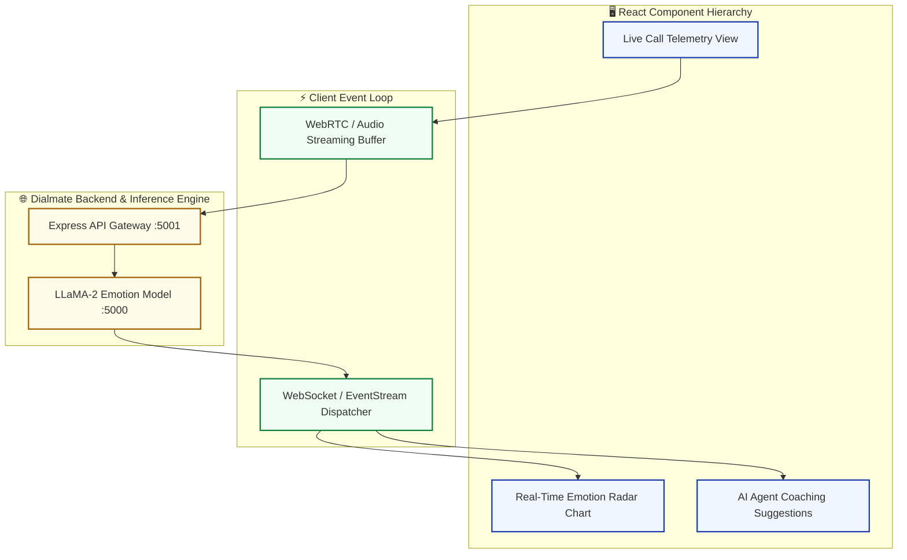

# Dialmate CallCopilot Frontend

<div align="center">

[](src/)
[](vite.config.js)
[](tailwind.config.js)

**The dedicated, low-latency agent client interface for DialMate CallCopilot.**

</div>

---

## 📌 System Architecture



---

## 🚀 Quick Start

```bash
# Clone the repository
git clone https://github.com/sayan-bhattacharya/DialMateFrontend.git
cd DialMateFrontend

# Install dependencies
npm install

# Start development server
npm run dev
```

---

## 📬 Contact

- **DialMate AI**: [dialmateai.com](https://dialmateai.com)
- **Author**: Sayan Bhattacharya ([sayanpm17@gmail.com](mailto:sayanpm17@gmail.com))
